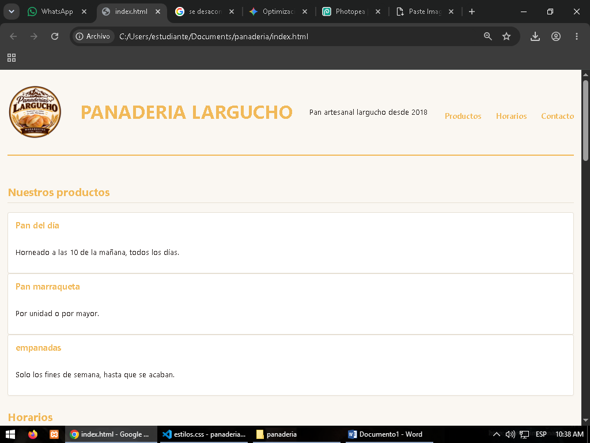
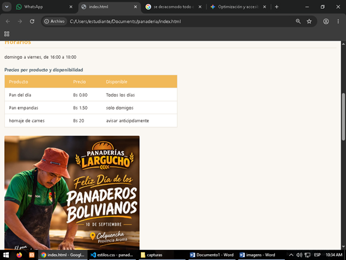
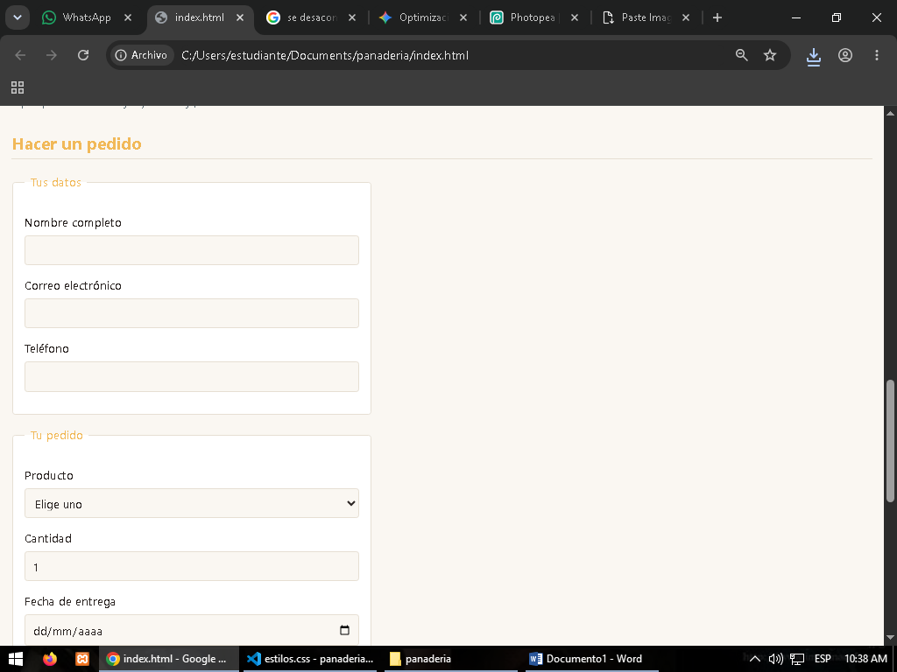
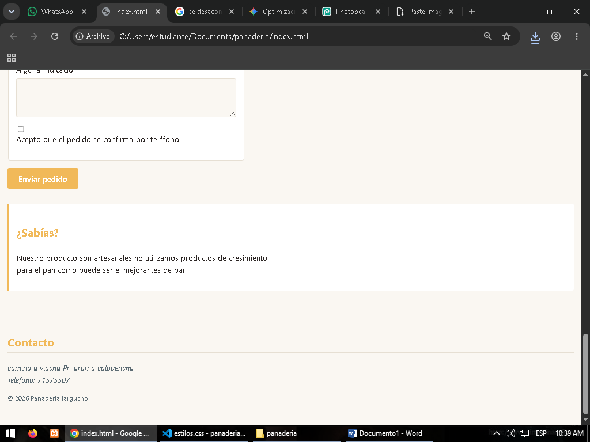

# Panadería Largucho

**Estudiante:** Rodrigo Mamani Mamani  
**Cliente:** Microempresa de Panadería  
**URL publicada:**  

---

## ¿Qué resuelve el proyecto?
El sitio web soluciona un problema crítico de control de inventario y previsión de la demanda en la panadería. En ocasiones, clientes casuales o eventuales compran grandes cantidades de pan sin previo aviso, lo que genera desabastecimiento y provoca que los clientes habituales se queden sin producto.

A través de esta plataforma web se implementa un sistema de reservas anticipadas. Esto permite a los clientes programar sus pedidos con antelación, garantizando su abastecimiento. Al mismo tiempo, optimiza la producción del horno artesanal, permitiendo calcular con precisión la cantidad exacta de pan que se debe hornear cada día para reducir el desperdicio de materia prima y asegurar la máxima frescura.

---

## Estructura y Arquitectura del Proyecto

El proyecto está organizado de manera modular en HTML5, CSS3 y JavaScript moderno (ES6+) con integración de jQuery y peticiones asíncronas:

```
panaderia/
│
├── index.html              # Estructura semántica completa de la página web
├── estilos.css             # Estilos y diseño responsivo (CSS moderno y variables)
├── datos.json              # Base de datos en formato JSON para consumo asíncrono
│
├── app.js                  # Inicialización y variables fundamentales del negocio
├── datos.js                # Catálogo de datos locales en JS, clases y métodos funcionales
├── funciones.js            # Funciones puras, arrow functions, scope y closures
├── render.js               # Renderizado dinámico de tarjetas de productos en el DOM
├── eventos.js              # Manejo de eventos: buscador en vivo, filtros y validación
│
├── jquery-3.7.1.min.js     # Librería jQuery para animaciones y utilidades
├── jquery-panel.js         # Menú móvil deslizable, acordeón interactivo y avisos
├── jquery-comparado.js     # Demostración comparativa de Vanilla JS vs jQuery
├── remoto.js               # Carga asíncrona de datos vía Fetch (async/await) y AJAX
│
├── logo.png                # Logotipo oficial de Panadería Largucho
├── panadero.jpg.jpeg       # Fotografía del horno artesanal
└── capturas*.png           # Capturas de pantalla de la interfaz
```

---

## Cómo está construido

### 1. Semántica HTML5
- **`<header>`**: Encabezado principal que contiene el título del negocio, slogan, logotipo y menú de navegación.
- **`<nav>`**: Navegación principal accesible tanto en versión escritorio como en versión móvil (`#menu-toggle` y `#menu-movil`).
- **`<main>`**: Agrupa las secciones centrales organizadas con `<section>`, `<article>`, `<figure>`, `<table>` y `<aside>`.
- **`<form>`**: Formulario de pedidos con validación semántica de campos (nombre, correo, teléfono boliviano, fecha de entrega y términos).
- **`<footer>` y `<address>`**: Información de contacto y ubicación de la panadería en Provincia Aroma, Colquencha.

### 2. Diseño y Maquetación CSS3
- **Paleta de colores cálida:**
  - `#f1b959`: Color dorado principal, usado en acentos, títulos y botones.
  - `#171616`: Color de contraste profundo para textos destacados y estados activos.
  - `#FAF7F2`: Fondo crema suave que evoca la harina y el calor de la masa horneada.
  - `#ffffff`: Superficie de tarjetas y contenedores con sombras sutiles.
- **Layout Adaptable:**
  - **CSS Grid:** Grilla automática y fluida para las tarjetas de productos (`#lista-productos` y `#lista-remota`).
  - **Flexbox:** Distribución del encabezado, controles de filtro y pie de página.
  - **Media Queries:** Adaptación garantizada para teléfonos móviles, tablets y pantallas de escritorio.

### 3. Nuevos Módulos y Lógica JavaScript
- **`render.js`:** Construye dinámicamente las tarjetas de producto (`.tarjeta`) en el DOM a partir de datos estructurados, mostrando disponibilidad, stock y precio formateado.
- **`eventos.js`:** Permite búsqueda en tiempo real (`input`), filtrado por categorías mediante botones ("Todos", "Panes", "Masitas") con delegación de eventos, y validación de fecha en el formulario de pedidos.
- **`jquery-panel.js`:** Implementa interactividad dinámica con menú responsive (`slideToggle`), acordeón de preguntas frecuentes con animación suave y avisos con efecto escalonado (`delay` + `fadeIn`).
- **`jquery-comparado.js`:** Laboratorio que ilustra la comparativa técnica entre la manipulación con Vanilla JS (`querySelector`, `classList`) y los métodos de jQuery (`$()`, `text()`, `toggleClass()`).
- **`remoto.js` & `datos.json`:** Demuestra el flujo de asincronía moderna (`fetch` + `async/await`) y clásico (`$.getJSON`), manejando los tres estados fundamentales: cargando, éxito y captura de errores (404/red).

---

## Capturas de Pantalla






---

## Lo más difícil del desarrollo
Uno de los mayores retos fue articular e integrar armónicamente los diferentes módulos de programación web aprendidos: desde la estructura semántica limpia y el diseño visual con CSS, hasta la manipulación dinámica del DOM con JavaScript moderno, la interactividad avanzada con jQuery y el consumo asíncrono de APIs y archivos JSON.
El resultado es un sitio web rápido, ordenado, accesible y de fácil navegación para todos los clientes de la panadería.